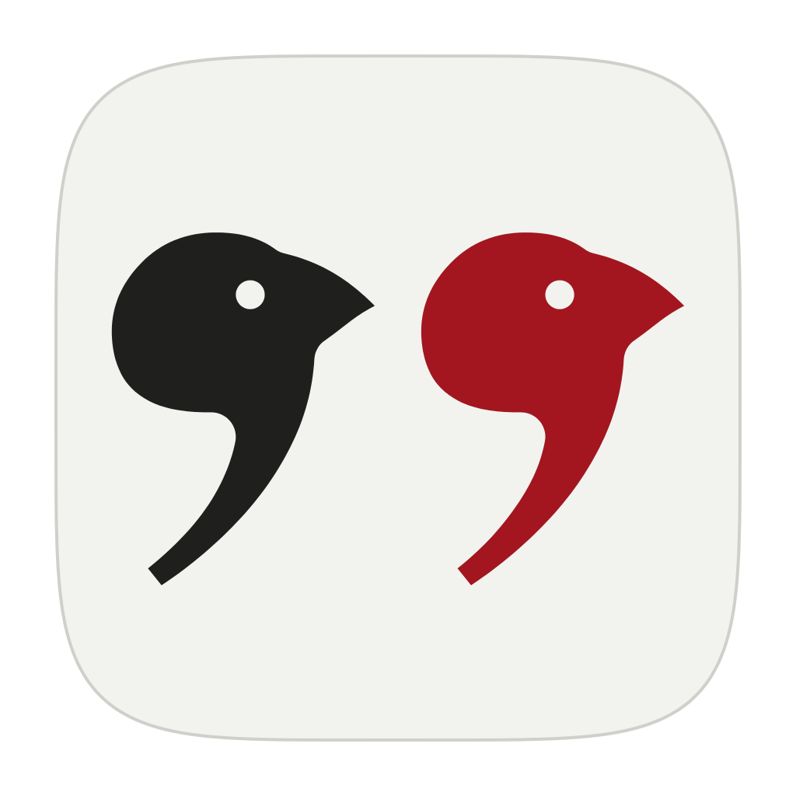
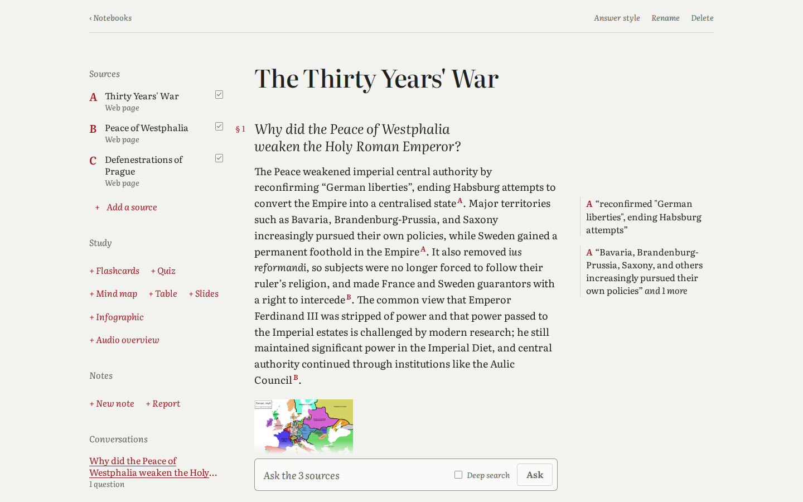
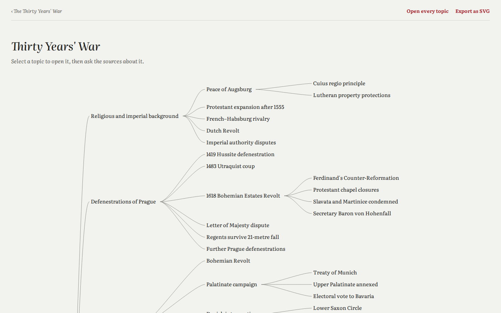
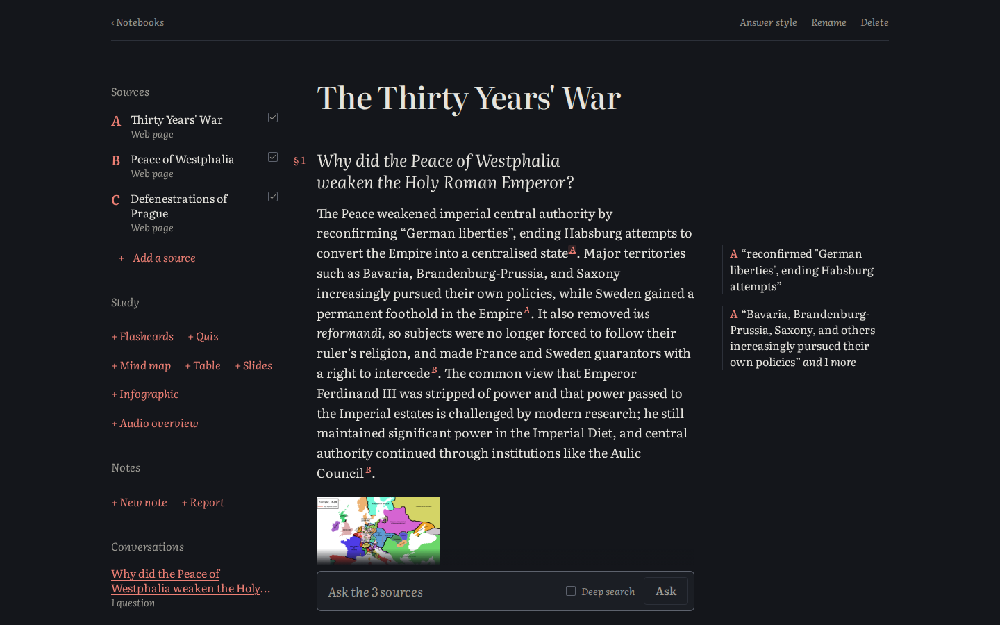
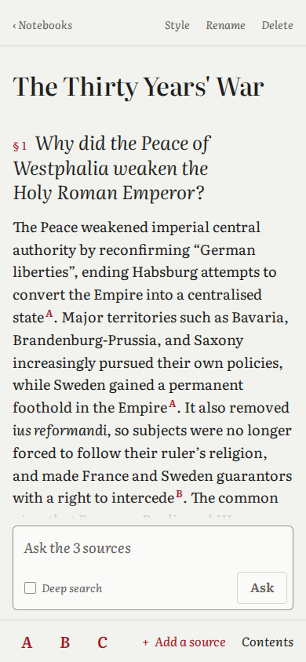

# Bowerbird



An open-source NotebookLM alternative where your files stay yours and every
quote is checked.

Add PDFs, books, web pages, YouTube videos and recordings, then ask
questions. Answers cite the passages they draw on, and each quoted phrase is
looked up in the source it cites. Notebooks are plain folders on your disk,
search, OCR and speech run on your machine, and answers come from any model
you choose.



## Every quote is checked

Each citation in an answer carries the words it quotes. Bowerbird looks those
words up in the source the citation names: in the cited passage, or in
another passage of the same source, since a quote can run across a
passage boundary. A quote that isn't there, or that the answer attributes to
the wrong source, is marked unverified, and the footer counts how many were
found. A quote shortened with an ellipsis counts only when each of its
pieces is long enough to stand on its own and the pieces sit close together.

The check shows that the quoted words are in the source, not that the answer
reads them correctly. Click a citation to open the passage with the quoted
words highlighted, or, for a PDF, the printed page, and judge for yourself.


## What leaves your machine

Notebooks, the search index, OCR, transcription and the voices of audio
overviews stay on your machine. Bowerbird sends no analytics and doesn't
check for updates. This is everything that goes out:

| What | Where it goes | When |
| --- | --- | --- |
| Your question, the earlier turns of that conversation, and the parts of your sources found for it | The model provider you choose, DeepSeek by default | Each question |
| The parts of your sources behind the notebook's overview | The same model provider | When you open a notebook whose sources changed |
| The parts of your sources a report or study material draws on | The same model provider | Each time you make one |
| A link you add | That website, and the sites its pictures are on | When you add it |
| A YouTube video you add | YouTube, for the video's captions | When you add it |
| A web search for sources | The search service set in Settings: your own SearXNG, DuckDuckGo, Brave, Tavily or Exa | Each search |
| Requests for the local models | Hugging Face and GitHub; each file is checked against its recorded SHA-256 | Each model's first use |

API keys go only to their own provider. Choose an
[Ollama](https://ollama.com) model running on your machine, and questions and
passages stay there too.

## What it does

- **Sources:** PDF, Word (.docx), EPUB, Markdown, plain text, web pages,
  YouTube captions, and audio recordings, which are transcribed on your
  machine with Whisper. Scanned PDFs are read with OCR on your machine
  (PP-OCRv5, Latin script including accented letters; Cyrillic and other
  scripts aren't read yet). Pictures in web pages, Word documents and EPUBs
  are kept beside their captions.
- **Search by keyword and by meaning:** passages are found with SQLite FTS5
  (BM25) and with EmbeddingGemma vectors, fused by weighted reciprocal rank,
  so a question worded differently from the source still finds it.
  Questions can be asked in a different language from the sources.
- **Notes:** save answers to notes, edit them, and add a note back as a
  source.
- **Reports:** a study guide, briefing, timeline, FAQ, or a report you
  describe, written into a note with citations.
- **Study material:** flashcards (with Anki export), quizzes, mind maps (SVG),
  data tables (CSV), slide decks (PPTX), infographics (SVG, PNG), and audio
  overviews in four formats, voiced on your machine with Kokoro.
- **Finding sources:** search the web through DuckDuckGo, SearXNG, Brave,
  Tavily or Exa, and add what you pick.
- **Runs where you work:** a web app served from your machine, a desktop app
  for Linux, macOS and Windows, and an Android app. Light and dark themes.



<p>
  
  
</p>

## Download

Builds for Linux (`.deb`, AppImage), macOS 13.4 or later (Apple Silicon
`.dmg`), Windows (portable `.zip`) and Android (64-bit ARM `.apk`) are
attached to each [release](https://github.com/jolovicdev/bowerbird/releases).
The macOS app is signed ad hoc, not notarized, so macOS blocks its first
launch: allow it under System Settings, Privacy & Security, Open Anyway. To
build from source, see [Build and run](#build-and-run).

## How it works

1. A source is extracted to text with its heading tree: PDF bookmarks or
   font sizes, HTML and Markdown headings, EPUB and Word structure. Scanned
   PDFs and recordings are first read by OCR or Whisper in the background.
2. The text is split into passages and indexed in SQLite with FTS5. The
   source is searchable as soon as that finishes.
3. In the background, each passage gets an EmbeddingGemma vector. Until a
   passage has one, keyword search answers alone.
4. A question's keyword hits and nearest passages by meaning are fused, each
   hit brings its neighbors in the same section, and a source that ranks
   among the candidates gets its best passage even if it misses the top 8.
   **Deep search** also lets the model pick whole sections from the outline.
5. The model answers with citations to passage labels such as `B12`, and each
   quoted span is matched against that passage's text.

## Models

The default model is `deepseek-flash`. Any provider that
[genai](https://github.com/jeremychone/rust-genai) supports works, including
OpenAI, Anthropic, Gemini, DeepSeek, Mistral, Groq, xAI, OpenRouter and
Ollama. In Settings, enter the model name (prefix it with the provider, as in
`groq::model-name`, to choose the provider yourself) and paste the provider's
API key.

Keys are saved in `settings.toml`, readable only by your user account:
`~/.config/bowerbird/` on Linux and macOS, `%APPDATA%\bowerbird\` on Windows,
or the path in `$BOWERBIRD_CONFIG`. A key set as an environment variable,
such as `DEEPSEEK_API_KEY`, works too.

The local models download on first use into `~/.local/share/bowerbird/models`
(`%LOCALAPPDATA%\bowerbird\models` on Windows): EmbeddingGemma 4-bit for
search (200 MB) when the first source is added, the OCR models (12 MB) for
the first scanned PDF, and the speech models when they are first used. Their
licenses, including the Gemma Terms of Use that cover EmbeddingGemma, are in
[THIRD_PARTY_NOTICES.md](THIRD_PARTY_NOTICES.md).

## Your data

Each notebook is a folder in `~/Bowerbird`, or in `$BOWERBIRD_HOME`:

```text
<notebook>/
  notebook.toml            title, answer style, sources (order, letters)
  sources/                 originals as added, plus OCR text and transcripts
  notes/<id>.md            Markdown notes
  chats/<id>.jsonl         one conversation: questions, answers, citations
  studio/<id>.json         flashcards, quizzes and other study material
  guide.json               overview and suggested questions
  .bowerbird/index.sqlite  search index and vectors, rebuilt when missing
```

Copying the folder backs up or moves the notebook.

## Build and run

Needs Rust 1.95 or newer and Node.js 22.17 or newer. On Debian or Ubuntu,
install the build tools and the desktop app's libraries first:

```sh
sudo apt-get install cmake clang libwebkit2gtk-4.1-dev libayatana-appindicator3-dev librsvg2-dev
```

```sh
scripts/fetch-pdfium.sh                  # PDFium, which reads PDFs, into vendor/pdfium
export BOWERBIRD_PDFIUM_DIR="$PWD/vendor/pdfium/lib"
npm --prefix ui ci
npm --prefix ui run build
cargo run --release -p bowerbird-server
```

The server prints a link with an access token. Open it in a browser. It
listens on `127.0.0.1:7477`; `--addr` changes that, and anything other than
a loopback address exposes your notebooks to the network, protected only by
the token. Links added through the server may only point at the public
internet, not at the server's own machine or its local network, unless it runs
with `--allow-private-links`. Leave that off when anyone else can reach the
server, directly or through a reverse proxy. The desktop app allows such links.

### Command line

The `bowerbird` command works on the same library:

```sh
cargo run --release -p bowerbird -- add history treaty.pdf https://en.wikipedia.org/wiki/Peace_of_Westphalia
cargo run --release -p bowerbird -- ask history "Who signed the treaty at Osnabrück?"
```

### Desktop app

On Linux, install [Tauri's prerequisites](https://v2.tauri.app/start/prerequisites/),
then:

```sh
ui/node_modules/.bin/tauri build --config crates/desktop/tauri.conf.json
```

The `.deb` and AppImage land in `target/release/bundle/`. On a Mac with
Apple Silicon, run `scripts/fetch-pdfium.sh` first and add
`--bundles app,dmg`; the `.dmg` lands in `target/release/bundle/dmg/`.

The Windows app cross-compiles from Linux with
[cargo-xwin](https://github.com/rust-cross/cargo-xwin) (needs clang 19 or
newer, lld and llvm):

```sh
scripts/windows.sh
```

The portable folder lands in `dist/bowerbird-windows`: `Bowerbird.exe` with
`DirectML.dll`, `pdfium\pdfium.dll` and the licenses beside it.

### Android

```sh
scripts/android.sh
```

Builds a 64-bit ARM APK. Needs the Android SDK and NDK, found through
`ANDROID_HOME` and `NDK_HOME`. The APK is signed with the release key that
`crates/desktop/gen/android/keystore.properties` names (`storeFile`, relative
to that folder, `keyAlias` and `password`; kept out of git), or with the
debug key when that file is missing.

## Tests

```sh
cargo test --workspace
npm --prefix ui run check
ui/node_modules/.bin/playwright install chromium     # once
cargo build -p bowerbird-server && npm --prefix ui run test:e2e
BOWERBIRD_LIVE=1 cargo test -p bowerbird-core --test live
BOWERBIRD_LIVE=1 cargo test -p bowerbird-core --lib -- "ocr::" "embed::" "retrieve::"
```

The end-to-end tests and the live test ask the default model real questions,
so they need `DEEPSEEK_API_KEY`. The end-to-end tests serve the UI from
`ui/build`, so build it first. The live test also checks YouTube captions,
web page extraction and DuckDuckGo; the last line downloads the OCR and
search models and reads a scanned page.

`node ui/scripts/readme-screenshots.mjs <url> <token> docs/screenshots`
rebuilds the demo notebook and the screenshots above. Run it against a
server whose `--library` is an empty folder; it asks the configured model real
questions.

### Continuous integration

- `.github/workflows/ci.yml`, on every push and pull request: formatting,
  clippy with warnings as errors, the workspace tests, the UI type check, and
  `cargo deny` for licenses (`deny.toml`) and advisories.
- `.github/workflows/live.yml`, daily: the live tests and the end-to-end
  tests. Needs the `DEEPSEEK_API_KEY` repository secret.
- `.github/workflows/release.yml`, weekly and on `v*` tags: the Linux,
  macOS, Windows and Android builds; a tag publishes them as a GitHub
  release. The APK gets the release key from the `ANDROID_KEYSTORE`
  (base64 of the keystore) and `ANDROID_KEYSTORE_PASSWORD` repository
  secrets.

## License

[MIT](LICENSE). The software by others in the releases, and the models the
app downloads, are listed with their licenses in
[THIRD_PARTY_NOTICES.md](THIRD_PARTY_NOTICES.md).
[ARCHITECTURE.md](ARCHITECTURE.md) describes how the code fits together.
